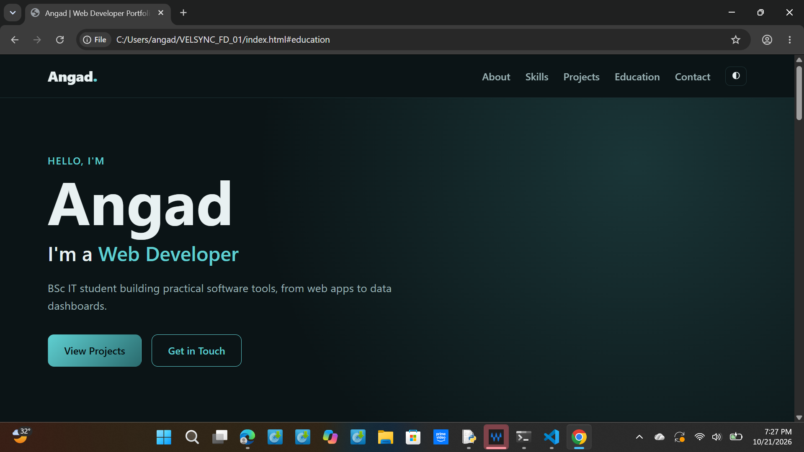

# VELSYNC_FD_01 - Personal Portfolio Website

Task 01 of the **Velsync Full Stack Web Development Internship** (track code: FD).

A clean, responsive personal portfolio that showcases my identity, skills and projects, built with plain HTML, CSS and JavaScript.

## Features
- Responsive layout that works on mobile, tablet and desktop
- Dark and light theme toggle (remembered with localStorage)
- Typing effect in the hero section
- Animated skill bars and scroll-reveal sections
- Project cards with tech tags
- Education and internship timeline
- Contact form with client-side validation

## Tech Stack
- HTML5
- CSS3 (custom properties, Grid, Flexbox)
- Vanilla JavaScript (IntersectionObserver, localStorage)

## Project Structure
```
VELSYNC_FD_01/
├── index.html
├── style.css
├── script.js
├── README.md
└── screenshots/
    └── home.png
```

## Run Locally
1. Clone the repo: `git clone https://github.com/<your-username>/VELSYNC_FD_01.git`
2. Open `index.html` in any browser. No build step is needed.

## Screenshots


## What I Learned
- Structuring a multi-section page with semantic HTML
- Theming with CSS variables
- Using IntersectionObserver for scroll animations
- Validating forms on the client side

## Author
**Angad** - BSc IT student, Mumbai University
Intern at Velsync (Full Stack Web Development)
